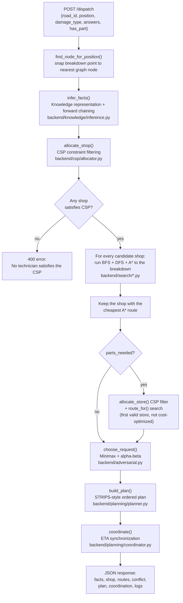

# System Overview — Car Breakdown Dispatch System

## 1. What the project is

A Flask web app that simulates dispatching a repair technician (and, if needed, a parts store) to a broken-down car. It is built explicitly as a teaching artifact for **classical / symbolic AI**: every stage of the dispatch decision is a separate, named AI technique, run in a fixed pipeline, with its reasoning steps printed as a human-readable log so the "why" behind every decision is visible.

There is no machine learning anywhere in this codebase. Every decision is made by hand-written rules, graph search, constraint checks, or game-tree evaluation — i.e. the toolbox that predates statistical/learned AI. That makes it a good vehicle for a "Fundamentals of AI" presentation: you can point at one function per topic (search, knowledge representation, CSP, adversarial reasoning, planning) and show it running live.

## 2. The scenario, in plain terms

1. A driver's car breaks down somewhere on a road (an edge in a small maze-like road network).
2. The driver reports **what broke** (engine, brakes, glass, tires, exhaust, internal parts, electronics) and answers one **follow-up question** about severity.
3. The system **infers** how urgent the job is and whether a spare part is needed (knowledge representation / inference).
4. It **filters** the pool of repair shops down to ones that are the right specialty, available, and close enough (CSP).
5. Among the surviving shops, it **finds and compares routes** (BFS, DFS, A*) and picks the technician with the cheapest route.
6. If a part is needed, it does the same for a parts store.
7. It runs a toy **two-request scheduling decision** through a minimax/alpha-beta evaluator to demonstrate adversarial reasoning.
8. It **builds an ordered repair plan** (diagnose → assign shop → assign store → travel → repair → verify → close) and checks which steps can legally start yet (planning).
9. It **synchronizes** technician and parts ETAs so the repair doesn't start before both arrive, and can **replan** if a delay is simulated.
10. The frontend draws the road network as an SVG maze and animates the chosen routes.

## 3. Request pipeline (the heart of the system)

Everything above happens inside `run_pipeline()` in `backend/app.py:67`, in this fixed order:



Every stage's `print()` statements are captured (via `contextlib.redirect_stdout` into an `io.StringIO`, see `backend/app.py:77`) and shipped back to the browser as a `logs` array, which the frontend plays back line-by-line to narrate the decision (`frontend/script.js:128`). This is the project's whole "explainability" conceit: nothing is a black box, every stage's internal trace is exposed verbatim.

A second endpoint, `POST /simulate-delay` (`backend/app.py:142`), re-enters only the **planning/coordination** stage — it does not re-run inference, CSP, or search — to demonstrate reactive replanning after an unexpected delay. See `07-planning.md`.

## 4. Problem formulation — environment & state space

Classical AI search/planning always starts with a *formal* problem definition. Here it is:

| Element | Representation in code |
|---|---|
| **State space** | A graph of 38 road-junction nodes and 45 weighted, undirected edges (`data/city_map.json`), loaded by `load_city_map()` (`backend/environment/city_map.py:5`) and turned into an adjacency list by `build_graph()` (`backend/environment/city_map.py:12`) |
| **Actions / successor function** | From any node, move along any incident edge to its neighbor, at a cost equal to the edge's `distance` |
| **Path cost** | Sum of edge `distance` values along a route (`path_cost()`, `backend/search/uninformed.py:17`) |
| **Initial state** | The graph node nearest the technician's/store's home location |
| **Goal state** | The graph node nearest the breakdown point, chosen by `find_node_for_position()` (`backend/app.py:34`), which snaps the clicked position on a road to whichever of that road's two endpoints is geometrically closer |
| **Agents / resources** | Repair shops and parts stores, each pinned to a node, loaded from `data/shops.json` |
| **Heuristic (for informed search)** | Straight-line (Euclidean) distance between two nodes' `(x, y)` coordinates, via `euclidean()` (`backend/utils/distance.py:4`) |

The map is deliberately maze-like: `tests/test_search.py:20` asserts the graph is fully connected, has more edges than a spanning tree would need (`len(edges) > len(nodes) - 1`, i.e. cycles/alternate routes exist), and still contains at least one dead end (`any(len(neighbors) == 1 ...)`). This guarantees that uninformed vs informed search can meaningfully disagree on which route is best — which is the whole point of demonstrating them side by side.

`backend/environment/entities.py` defines `Request` and `Assignment` data classes, but neither is actually instantiated anywhere in the pipeline — plain dicts are used instead throughout `app.py`. Worth knowing if you're asked "what's this file for" — it reads as a design sketch for a more object-oriented version that the implementation didn't end up using.

## 5. File map

| File | AI technique | Covered in |
|---|---|---|
| `backend/knowledge/rules.py`, `questions.py` | Production rules / knowledge base | `02-knowledge-representation.md` |
| `backend/knowledge/inference.py` | Forward chaining | `02-knowledge-representation.md` |
| `backend/csp/constraints.py`, `allocator.py` | Constraint satisfaction, backtracking search | `03-csp.md` |
| `backend/search/uninformed.py` | BFS, DFS | `04-search-uninformed.md` |
| `backend/search/informed.py` | A* with admissible heuristic | `05-search-informed.md` |
| `backend/adversarial.py` | Minimax with alpha-beta pruning | `06-adversarial-search.md` |
| `backend/planning/planner.py`, `coordinator.py` | STRIPS-style planning, replanning | `07-planning.md` |
| `backend/environment/`, `backend/utils/`, `data/*.json` | Problem formulation / state space | this file |
| `backend/app.py` | Orchestration (glues every stage together) | this file |
| `frontend/*` | Visualization only, no AI logic | `08-frontend.md` |

## 6. Tech stack

- **Backend:** Python, Flask (`requirements.txt` pins `Flask>=3.0,<4.0`). No database — `data/*.json` is loaded into memory once at startup (`backend/app.py:28-31`) and the app is otherwise stateless between requests (the frontend holds the current plan/coordination in JS variables and sends it back for replanning).
- **Frontend:** Vanilla JS + hand-drawn SVG (`frontend/script.js`, `frontend/index.html`, `frontend/style.css`) — no framework, no build step.
- **Tests:** `pytest`, in `tests/`, covering search correctness, CSP specialty filtering, planning preconditions, and one end-to-end `/dispatch` smoke test.

## 7. Running it

```bash
uv venv && source .venv/bin/activate
uv pip install -r requirements.txt
python backend/app.py        # serves http://127.0.0.1:5000
python -m pytest -q          # run the test suite
```
