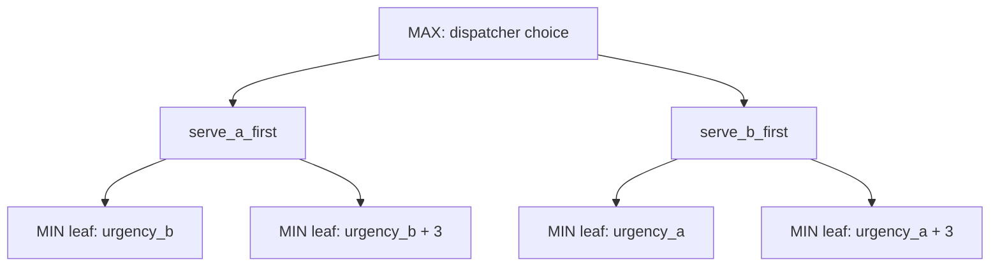

# Adversarial Search — Minimax with Alpha-Beta Pruning

**Code:** `backend/adversarial.py`

## 1. The AI concept

**Minimax** is the standard decision procedure for two-sided scenarios where one side (**MAX**) wants to maximize an outcome and the other side (**MIN**) wants to minimize it. It builds a game tree of possible choices and counter-choices, propagates values up from the leaves, and MAX picks the branch whose MIN-guaranteed value is highest — i.e. MAX plans for the *worst case* the opposing side can force.

**Alpha-beta pruning** is an optimization on top of minimax: it tracks the best value MAX can already guarantee (`alpha`) and the best value MIN can already guarantee (`beta`) as the tree is explored, and stops examining a branch early the moment it proves that branch can't beat what's already guaranteed elsewhere — this never changes the final decision, it just avoids wasted work.

Minimax doesn't require a literal "opponent" — it's equally valid whenever you want to plan around a **worst-case** possibility, treating "the worst thing that could happen" as if it were an adversary's move. That's exactly how this project uses it.

## 2. What's being decided

```python
def choose_request(request_a, request_b):
    """2-ply minimax: dispatcher (MAX) picks who to serve first; the MIN
    layer represents worst-case urgency escalation for whoever waits."""
```

The scenario: two breakdown requests are competing for the same dispatcher attention. Whichever one is served *second* has to wait, and while it waits its urgency might escalate (a problem left unattended can get worse). The dispatcher (**MAX**) wants to choose an ordering that maximizes `(urgency served) − (urgency of the one left waiting)`; the escalation itself is modeled as **MIN** — the "worst case" layer, because we can't know in advance whether the waiting job's urgency will escalate or not, so minimax conservatively assumes it might.

## 3. The two-ply tree

```python
ESCALATION = 3
alpha = float("-inf")
options = [
    ("serve_a_first", request_a, request_b),
    ("serve_b_first", request_b, request_a),
]
best_choice = None
best_value = float("-inf")
pruned = 0

for label, served, waiting in options:                      # <-- MAX layer: 2 branches
    outcomes = [waiting["urgency"], waiting["urgency"] + ESCALATION]
    min_value = float("inf")
    for outcome_urgency in outcomes:                         # <-- MIN layer: 2 leaves per branch
        value = served["urgency"] - outcome_urgency
        if value < min_value:
            min_value = value
        if min_value <= alpha:                                # <-- alpha-beta cutoff
            pruned += 1
            break

    if min_value > best_value:
        best_value = min_value
        best_choice = label
    alpha = max(alpha, best_value)

winner = request_a if best_choice == "serve_a_first" else request_b
return {"winner": winner, "value": best_value, "nodes_pruned": pruned}
```



Reading it as a textbook game tree:

- **Root (MAX):** two branches, "serve request A first" or "serve request B first."
- **Each branch has a MIN node** with two possible leaves: the waiting request's urgency either stays the same, or escalates by a fixed `ESCALATION = 3`. MIN "picks" (i.e. the algorithm conservatively assumes) whichever leaf gives the *lower* value for that branch — modeling the worst case for the dispatcher.
- **MAX then compares** the two branches' MIN-guaranteed values and picks the larger one — the ordering that's best even in its own worst case.
- **Alpha-beta pruning:** `alpha` tracks the best value MAX has secured from an already-fully-explored branch. While evaluating the *second* branch's MIN leaves, if a leaf's running `min_value` already drops to `alpha` or below, the loop `break`s out of checking that branch's remaining leaves (`pruned += 1`) — because MIN will never pick something *higher* than what already dooms this branch below the alternative, so there's no way this branch can still beat `alpha` no matter what the rest of its leaves hold. This mirrors the classic alpha-beta rule ("if a MIN node's bound ever falls to or below an ancestor MAX's `alpha`, stop examining it") even though it's written iteratively rather than as a textbook recursive `minimax(node, alpha, beta, maximizing_player)`.

## 4. Where it plugs into the pipeline

```python
conflict = choose_request(
    {"id": "current", "urgency": facts["urgency"]},
    {"id": "other", "urgency": 0},
)
```

(`backend/app.py:99-102`) The *real* breakdown's urgency (from the knowledge/inference stage, `02-knowledge-representation.md`) is compared against a **placeholder second request with urgency fixed at 0**, representing a generic, lower-priority competing job rather than a second real breakdown captured from the UI.

**Presentation-important nuance:** because `request_b`'s urgency is always `0`, working through the arithmetic shows `choose_request` will pick `"serve_a_first"` (the real request) for essentially every realistic urgency value the knowledge engine can produce (1–10). In the current pipeline, this stage's *outcome* rarely changes anything — its value is in demonstrating the **mechanism** (the minimax comparison, the alpha-beta cutoff counter in `nodes_pruned`) live in the trace log, rather than in making a consequential decision. `choose_request()` itself is general — it takes two real request dicts and would meaningfully arbitrate between two genuine competing breakdowns — the hook for a true multi-request dispatch scenario is there; the live demo just doesn't yet feed it a second real request.

## 5. Presentation talking points

- This is a **decision-theoretic use of minimax** — planning for a worst-case outcome (urgency escalation) rather than a literal two-player adversary. That's a legitimate and common use of game-tree search in AI (also how it's used in robust planning / risk-averse decision-making).
- The alpha-beta cutoff is implemented as an early `break` once a branch's running worst case can no longer beat the already-secured `alpha` — same pruning *logic* as the textbook recursive algorithm, just flattened into two nested loops since the tree here is a fixed depth-2 shape.
- `nodes_pruned` is a genuine, inspectable count of how many leaf evaluations alpha-beta skipped versus plain minimax — a good number to show on a slide to make "pruning saves work" concrete.
